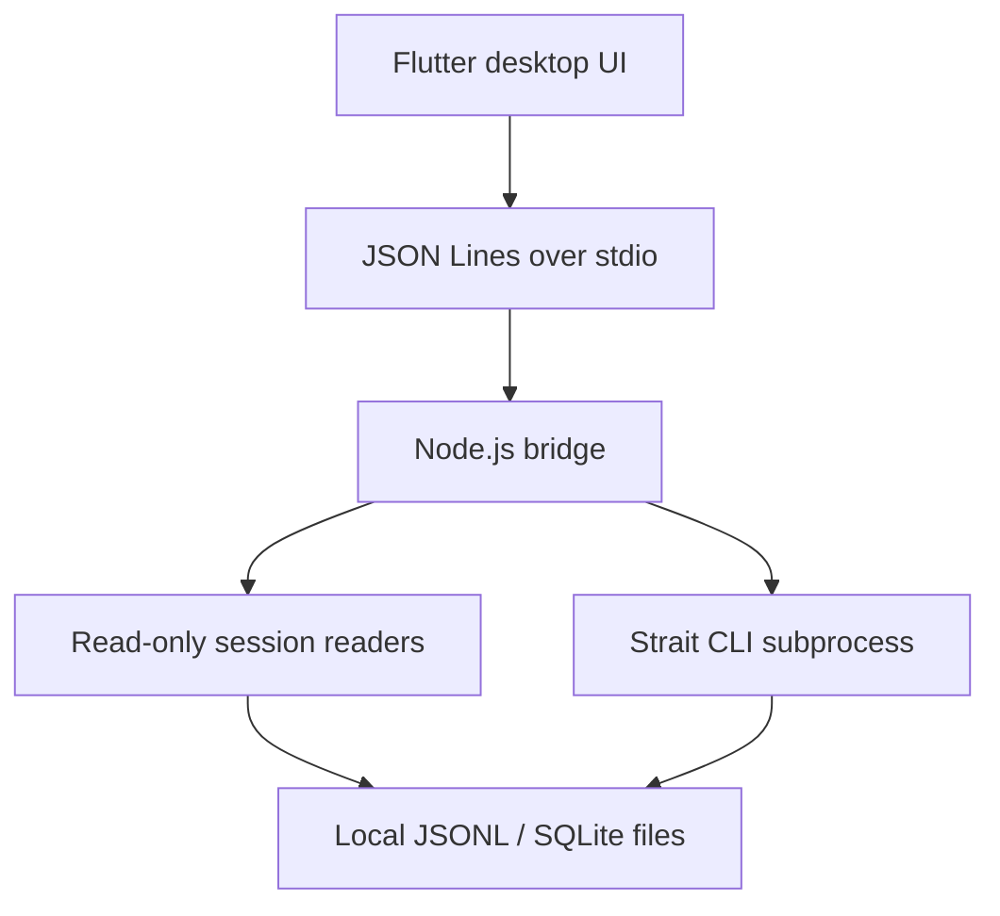

# Architecture and integration contract

## Boundaries



The Flutter process never opens agent databases and never executes the converter itself. The bridge accepts a finite command set, scans known user session locations, and runs the Strait CLI with validated arguments and `shell: false`.

Strait's internal session IR defines roles and blocks (`text`, `tool_call`, `tool_result`, `thinking`, `image`). The GUI uses a **presentation-only** normalized representation that does not expose private thinking text or binary image data. For copies, the application always delegates to `strait sync`; the presentation reader is not a converter.

## Bridge lifecycle

`BridgeClient` starts `node bridge/bin/bridge.mjs` on demand and keeps it running until app disposal. One JSON object per line goes to stdin; the bridge writes one response per line to stdout. It does not start a server or open a port. `BridgeClient` associates requests with incremental IDs and enforces a three-minute client timeout.

Example request:

```json
{"id":1,"method":"read","params":{"runtime":"codex","id":"01234567-89ab-4cde-8fab-0123456789ab"}}
```

Successful response:

```json
{"id":1,"result":{"id":"01234567-89ab-4cde-8fab-0123456789ab","runtime":"codex","cwd":"/example/project","messages":[{"role":"user","timestamp":"2026-01-01T10:00:00Z","blocks":[{"type":"text","text":"Hello"}]}],"warnings":[]}}
```

Error response:

```json
{"id":1,"error":"Session not found"}
```

## Methods

| Method | Parameters | Response | Side effects |
| --- | --- | --- | --- |
| `scan` | `{}` | `{providers:[{id,available,count}],straitInstalled,...}` | None |
| `list` | `{}` | `{sessions:[{id,runtime,title,preview,updatedAt,cwd,messageCount}]}` | None |
| `read` | `{runtime,id}` | `{id,runtime,cwd,messages,warnings}` | None |
| `sync` | `{from,to,sessionId}` | `{stdout,stderr,targetId,resume}` | Strait writes a new target session |

The runtime enum is `claude | codex | opencode`. UI filters apply locally without rescanning. The bridge limits returned session lists, clips unusually long text and rejects individual JSONL files larger than 200 MB. Do not pass untrusted filesystem paths from Flutter to Node: `read` resolves the supplied session ID against discovered sessions.

## Storage paths

| Runtime | Default discovery |
| --- | --- |
| Claude Code | `~/.claude/projects/**/*.jsonl` |
| Codex | `~/.codex/sessions/**/*.jsonl` |
| OpenCode | `~/.local/share/opencode/opencode.db`, with Windows APPDATA/LOCALAPPDATA fallback or explicit override |

The bridge opens OpenCode SQLite with `sql.js` in memory to support read-only previews. The tool may not see uncheckpointed WAL writes; surface that warning. On write, the upstream Strait emitter controls database mutation and must pass safety guards first.

## Packaging strategy

In development, both Node.js and the global `strait` command are external prerequisites. A later release should bundle a pinned Node runtime, the bridge (`sql.js` WASM), and a pinned compatible Strait distribution per OS. Native Flutter platform scaffolds will be generated with `flutter create` and committed after owner validation. The browser/network is not part of the runtime architecture.

